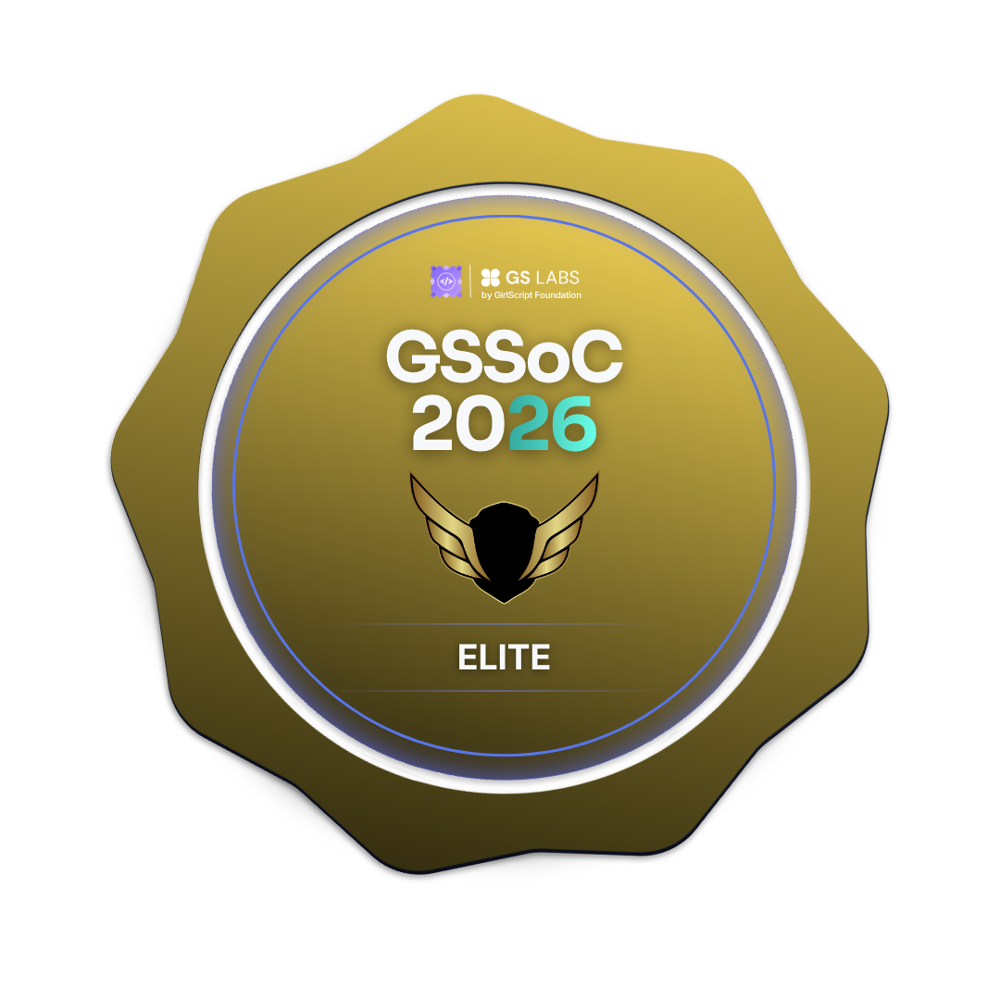
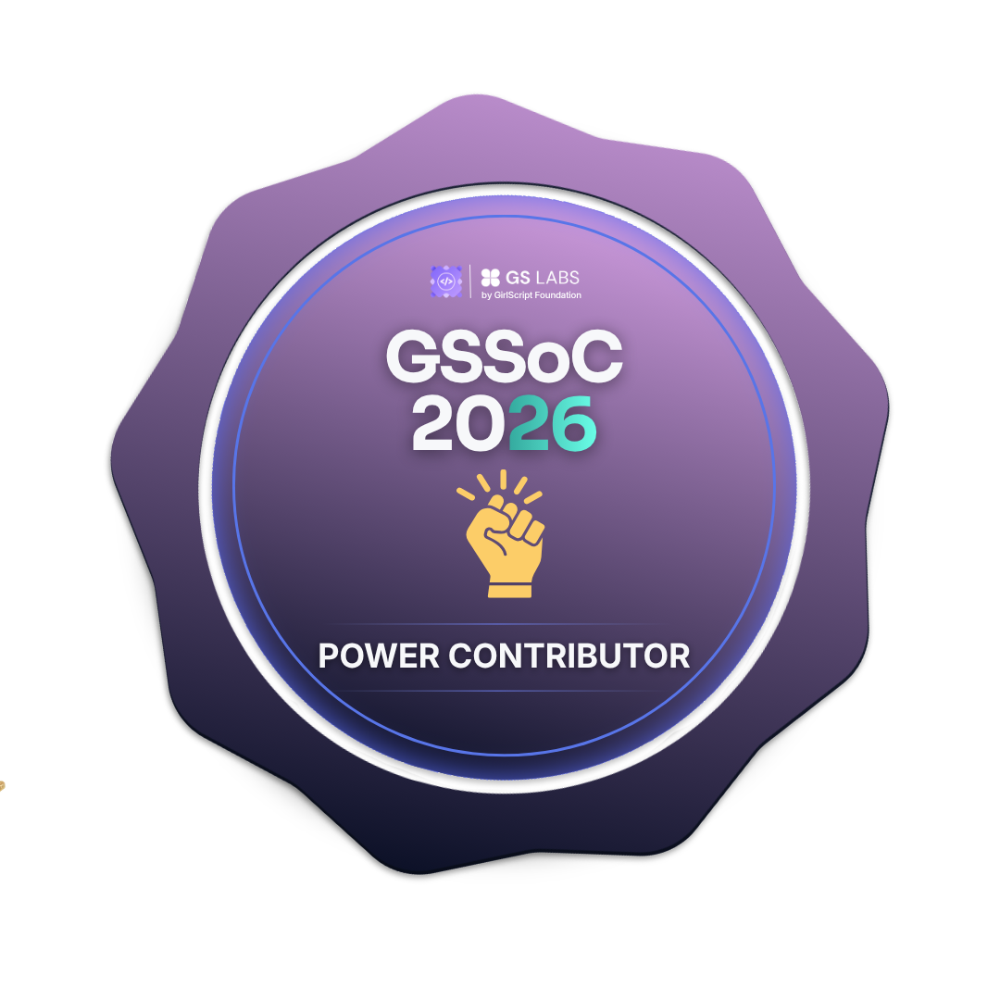

<!-- Top GIF / Banner -->

  

<h1 align="center">Hi 👋, I'm Shibam Dey Roy</h1>

  

  

## 🧠 About Me  

I enjoy turning ideas into real, working products.  
Currently focused on mastering the MERN stack and building scalable web apps.

- 🔧 Building full-stack apps with real-world workflows  
- 📈 Learning advanced backend & performance optimization  
- 🤝 Open to open-source collaboration
- 🔥 Contributing through pull requests, issue fixes & feature development
- 🌱 Exploring large-scale real-world codebases  

---

## 🌐 Connect With Me  

  
  
  
  
  

## 💻 Tech Stack  

### 🧠 Programming Languages  

  

### 🎨 Frontend Development  

  

### ⚙️ Backend Development  

  

### 🗄️ Database  

  

### ☁️ Cloud & Deployment  

  

### 🛠️ Tools & Technologies  

  

---

### 🏆 Open Source Work · 2026

<strong>GirlScript Summer of Code 2026</strong>
 
Open Source + AI/Agents Track
  

&nbsp;&nbsp;

&nbsp;&nbsp;

  

  

  

<em>Active open-source contributor through pull requests, issue fixes, feature development and collaborative projects.</em>

  

---

## 📈 Contribution Graph

 

---

## 📊 GitHub Stats  

  
  

---

## 🐍 Contribution Snake  

  
  

---

## ✍️ Dev Thought  

> Code is not just about solving problems, it's about building things people actually use.

---

## 🔥 Current Focus  

- Building production-level full stack apps  
- Improving backend architecture  
- Writing cleaner, scalable code  

---

⭐ If you like my work, feel free to connect — always open to good conversations and ideas.
